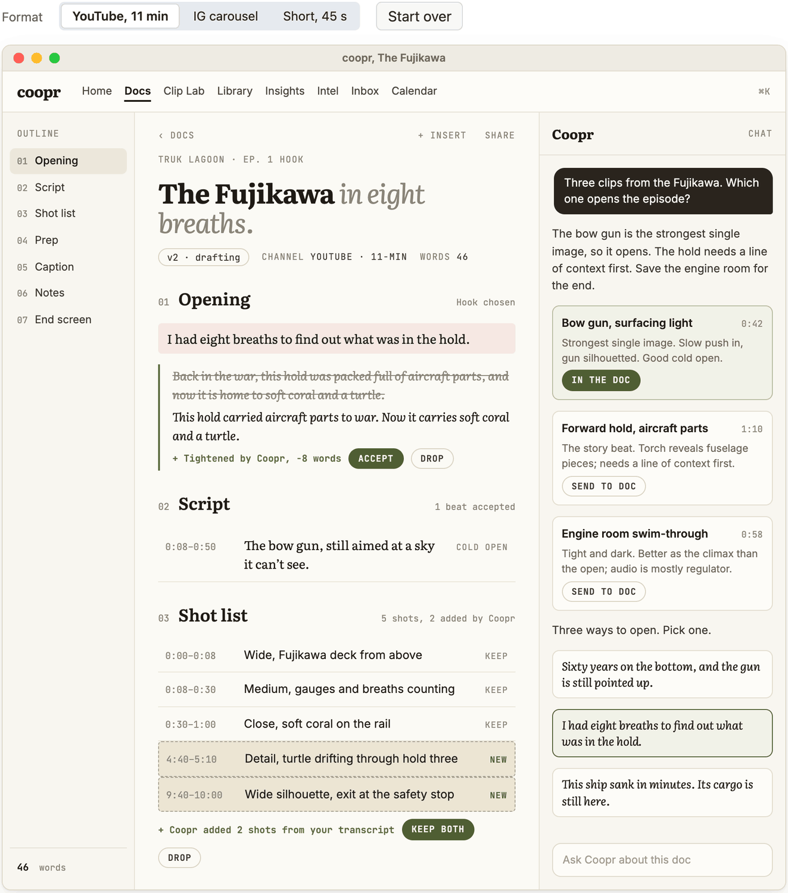
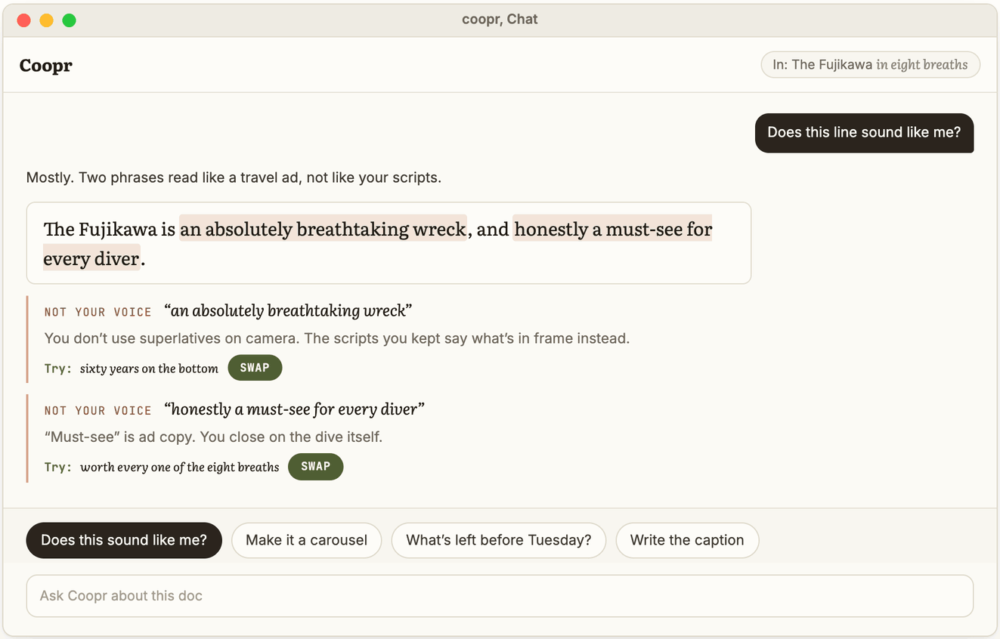
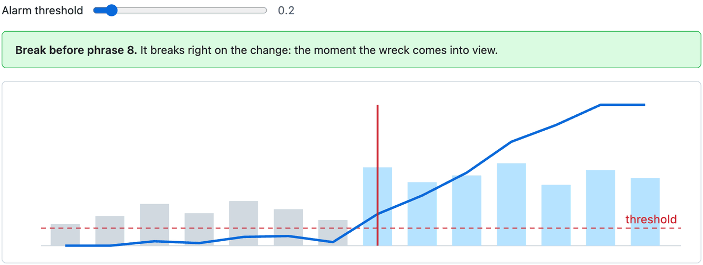
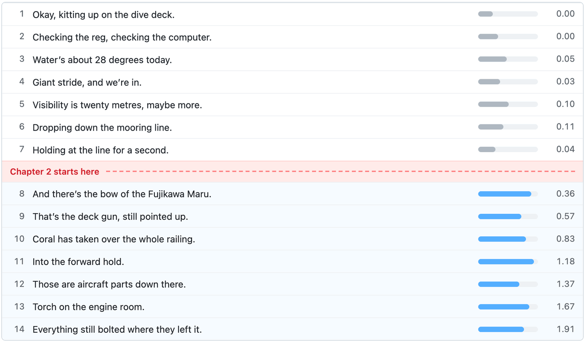
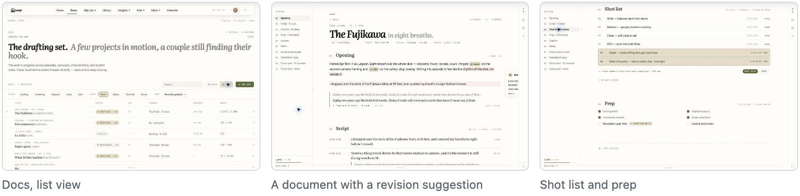

# COOPR

**A creator workspace where the conversation turns into the document.** Drop in a few clips, talk it through, and the parts you accept land in an editable plan: the hook, the script, the shot list, the filming notes. Nothing gets written into the document unless I accept it. Behind it is Content Brain, the analysis and memory the chat draws on.

Built with React and TypeScript over Python tools and PostgreSQL. Content Brain runs the audio and motion diagnostics and the change-point detection, and Reef reads it through a read-only client.

## Talk it into a document

Send a clip to the doc, pick a hook, and accept or drop the rewrite Coopr suggests. Then switch formats: the same accepted material becomes an episode script, carousel slides or a short.

A rebuild of COOPR's Docs view with sample content, not a screen capture. The prototype runs this flow on fixture data, not a live analysis backend. The Truk Lagoon episode is the prototype's own sample project.

## Ask Coopr

The chat doesn't answer in paragraphs. Each answer arrives as something you can act on: flagged phrases to swap, slides to send to the doc, a checklist Coopr can finish, two captions to choose from. The loop asks all four.

A rebuild of COOPR's chat with sample content, not a screen capture. The checklist and the two-caption choice follow the prototype's own Prep and Caption sections; the voice check stands in for its style-profile scoring, with sample flags rather than real scores.

## What it does

| Workflow | What happens |
| --- | --- |
| Compare clips | Upload a few takes, review the suggestions about each, and send the ones you accept into a document. |
| Write | Pick a hook, then develop the script and what to shoot next. Every part stays editable. |
| Check the voice | Writing is scored against a style profile, so the draft sounds like me and not like a template. |
| Repurpose | Editable variants for a long episode, a carousel or a short. They're plans to shoot from, not rendered videos. |

## Where does the topic change?

To cut a long talking clip into chapters, Content Brain looks for the point where what I'm saying actually shifts. It compares each phrase with the one before, and a **CUSUM** adds up how far those comparisons drift above normal. One odd phrase doesn't trip it; a sustained change does. The loop raises the threshold; watch the break move.

Grey and light-blue bars are each phrase's distance from the one before. The blue line is the running CUSUM total; the red line is where it crosses the threshold.

A sample dive narration with hand-set distances, run through the textbook one-sided CUSUM: <code>S = max(0, S + d − μ₀ − k)</code>, break when S passes the threshold. The right column is S after each phrase. COOPR also has a separate PELT detector for regime changes.

## The prototype

The interface is a prototype in its own design language: ivory paper, one cocoa ink, moss as the only accent, Literata for editorial headlines and every number in tabular mono. It has eight workspaces: Home, Docs, Clip Lab, Library, Insights, Intel, Inbox and Calendar.

Screenshots of the prototype with its sample content.

## Inside

- A React and TypeScript creator workspace over Python and PostgreSQL tools
- Clip comparison, suggestion review, and accepted suggestions written into editable documents
- Hook selection, script and filming-note development, style-profile scoring and repurposing variants
- Audio and motion diagnostics, CUSUM semantic change detection and a separate PELT regime detector
- Evidence-retrieval fallbacks when the first source comes back thin
- A retention-model experiment: gradient-boosted regression with pseudo-label and scarce-label handling
- Reef reads Content Brain through a read-only, tenant-bound client that trusts nothing it returns raw

## Notes

Each workflow above exists in source, but not every handoff between them is proven. For example, I haven't verified that a ranked clip opens straight into Clip Lab. The retention model is real ML code, but I'm not claiming any accuracy for it. COOPR and Social Lab solve related creator problems in separate codebases. The product source is private.

## Related

- [henryhcooperr profile](https://github.com/henryhcooperr)
- [reef, which reads Content Brain](https://github.com/henryhcooperr/reef)
- [reef-social-lab, a different creator problem](https://github.com/henryhcooperr/reef-social-lab)
- [reef-algorithm-studies](https://github.com/henryhcooperr/reef-algorithm-studies)
